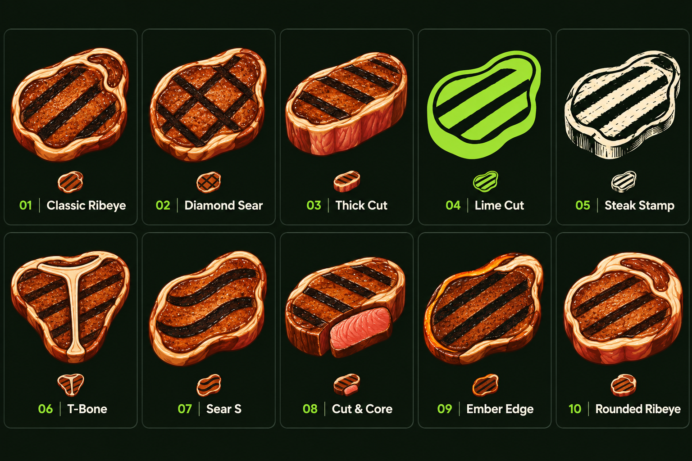
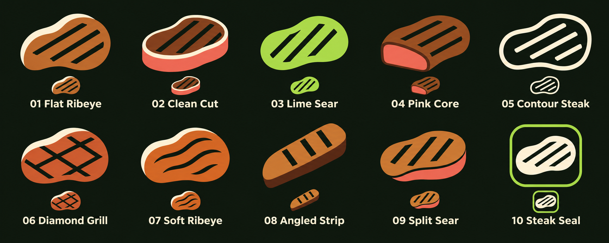
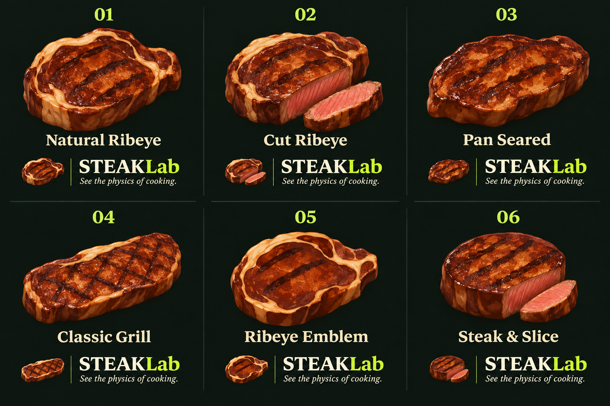

# STEAKLab project art

Saved artwork and visual directions for future use. These concept sheets are not loaded by the simulator.

## 01 · Grilled steak concepts

Ten illustrated steak icons with sear marks, including flat, dimensional and monochrome directions.

## 02 · Stylised steak concepts

Ten simpler proposals using broad shapes, fewer colours and clear grill marks.

## 03 · Ribeye brand concepts

Six more natural steak illustrations with wordmarks. **Concept 02, Cut Ribeye, was selected for the dashboard and repository README.** The slogans shown on this exploration sheet are drafts; the implemented slogan is “Cooking physics, visualised.”

## Implemented artwork

- [Selected Cut Ribeye — full-size transparent PNG](../assets/steaklab-ribeye.png)
- [Selected Cut Ribeye — compact PNG embedded in the offline app](../assets/steaklab-ribeye-small.png)
- [Earlier SVG logo exploration](../design/logo-concepts.html)

Concept sheets and the selected illustration were generated with OpenAI image generation during the project's design process. They are branding illustrations, not anatomical reference drawings. Original generated files were copied without alteration; the compact production asset is resized for the app. User-supplied reference photographs are not included here.
